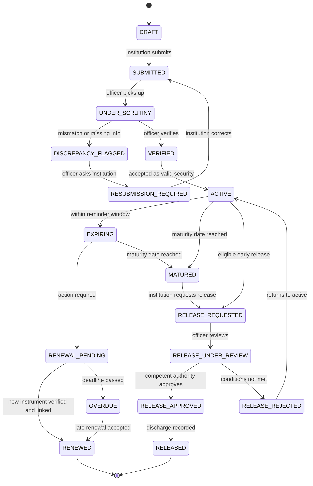
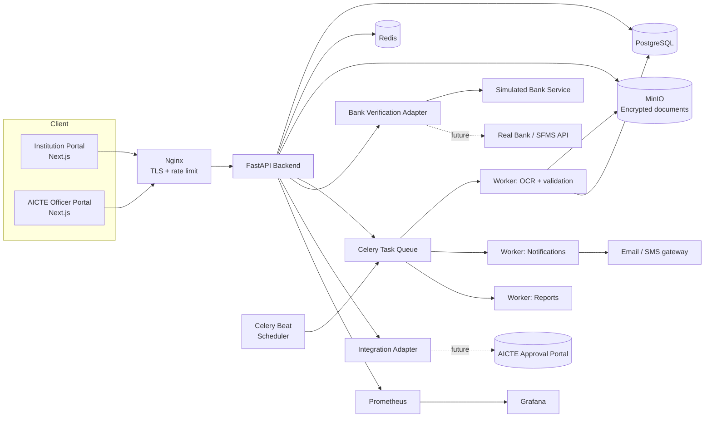
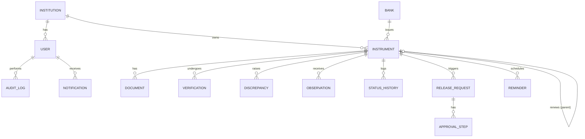
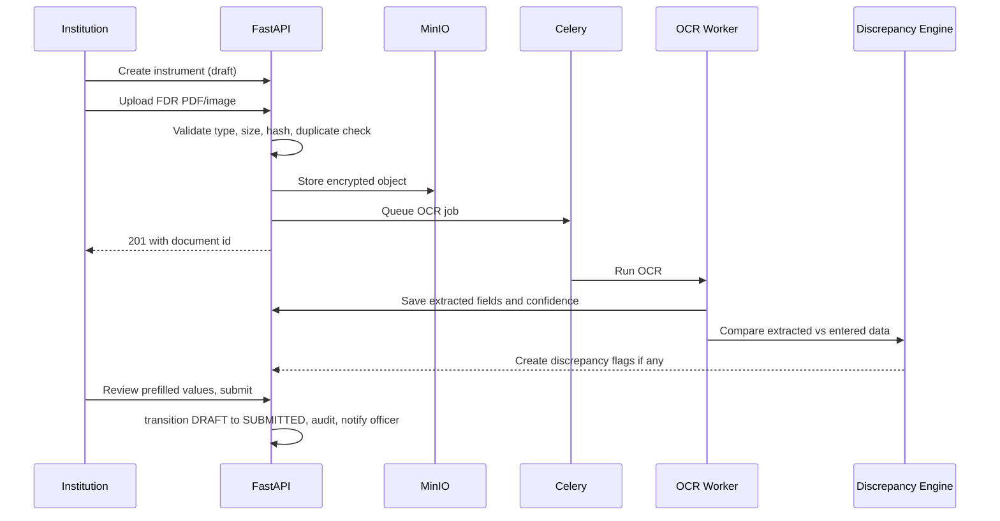
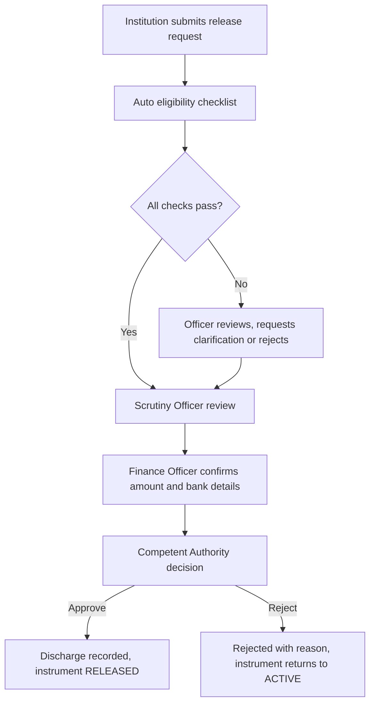
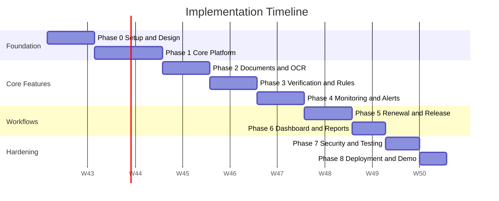
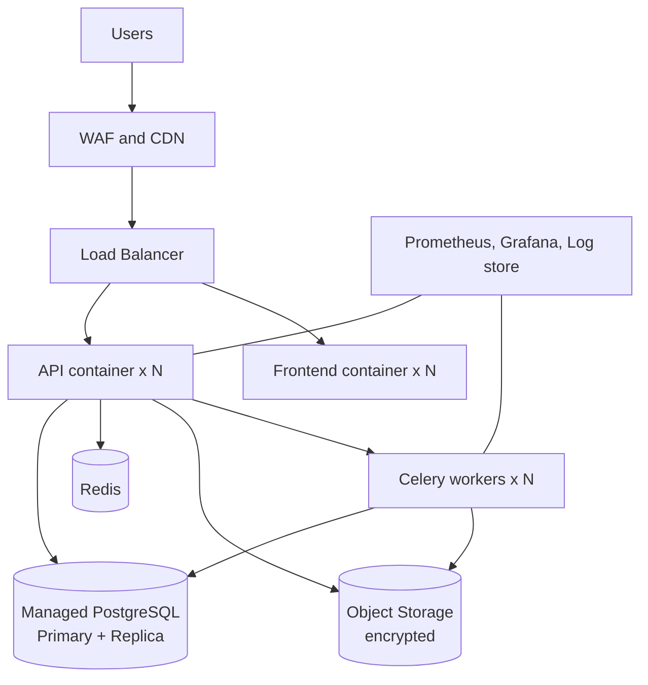
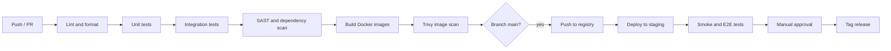

# Implementation Plan: Security Deposit / FDR Management Portal

**Problem Statement ID:** 26265
**Title:** Streamline of Security Deposit / FDR Portal
**Organization:** AICTE, Ministry of Education, Govt. of India
**Department:** Regulation Bureau
**Category:** Software

---

## 0. How to Read This Document

This is a build-order document. It tells you what to build, in what sequence, with which tools, and how to prove it works. Sections 1 to 4 set up context and decisions. Sections 5 to 12 are the technical build guide. Sections 13 to 20 cover execution, testing, deployment and risk.

---

## 1. Project Summary

### 1.1 What we are building

A secure, centralized web portal where:

- **Institutions** submit and maintain Security Deposits / FDRs and request release or refund.
- **AICTE Regulation Bureau officials** verify instruments, record scrutiny observations, track validity and maturity, and process release requests.
- **The system** automatically tracks dates, sends reminders, escalates overdue cases, flags discrepancies, and keeps a tamper-evident audit trail.

### 1.2 The three ideas that make this solution stand out

1. **Trust-level separation.** Every data point is tagged as *Institution-Submitted*, *Officer-Verified*, or *Bank-Confirmed*. The problem statement explicitly asks for this distinction, so it is built into the data model and shown in the UI.
2. **Lifecycle state machine.** Each FDR moves through a defined set of states with enforced transitions. No one can skip a step, and every transition is logged.
3. **Measurable impact.** The prototype instruments itself (turnaround time, reminder lead time, manual-effort proxy) so the demo shows numbers, not just screens. The problem statement asks for measurable improvement, so this is a first-class feature.

### 1.3 Scope boundaries

| In scope (prototype) | Out of scope (documented as future work) |
|---|---|
| Full lifecycle workflow (submit to release) | Live production integration with real bank APIs |
| Pluggable bank verification adapter with a simulated bank service | Live integration with AICTE's production approval portal |
| OCR-assisted data extraction from uploaded FDR documents | Actual fund movement or payment processing |
| Dashboard, reports, reminders, escalations | Native mobile apps |
| RBAC, MFA, encryption, audit trail | Formal STQC / CERT-In audit (we prepare for it) |

---

## 2. Assumptions

Where the problem statement is silent, these assumptions apply. Change them early if the mentors or the AICTE team say otherwise.

| # | Assumption |
|---|---|
| A1 | Real bank verification APIs are not available to us. We build a **Bank Verification Adapter** interface with a **simulated bank service** (mock) and document how a real bank/SFMS/CBS integration would plug in. |
| A2 | AICTE's existing systems expose no public API for us. We build an **Integration Adapter** with a CSV/Excel bulk-import path and a mock REST connector. |
| A3 | An institution is identified by a unique **Permanent ID / Application ID** (AICTE-style). We use a placeholder format `1-XXXXXXXXXX`. |
| A4 | One institution can hold multiple instruments. One instrument may be renewed or replaced many times, forming a **chain** (renewal history). |
| A5 | Release or refund requires approval by a **Competent Authority** after Finance/Accounts confirmation and compliance checks. |
| A6 | Reminder thresholds are configurable. Defaults: 90, 60, 30, 15, 7 and 1 days before maturity. |
| A7 | The prototype is deployed on a single cloud VM or local Docker Compose. A Kubernetes path is documented but not required. |
| A8 | Data used in the demo is synthetic. No real institution or bank data is used. |
| A9 | English UI for the prototype. Hindi i18n is a stretch goal. |
| A10 | Team size is 6 members. Timeline is 8 weeks (adjustable in section 15). |

---

## 3. Technology Stack and Rationale

The best option is listed first with the reason. Alternatives are noted with trade-offs.

| Layer | Choice | Why this choice | Alternative and trade-off |
|---|---|---|---|
| Frontend | **Next.js 14 + TypeScript + Tailwind CSS + shadcn/ui** | Fast to build, strong typing, good accessibility defaults, easy dashboards | Plain React + Vite: simpler, but no SSR or routing conveniences |
| Charts | **Recharts** | Simple, React-native, enough for dashboard KPIs | ECharts: more powerful, heavier |
| Backend API | **FastAPI (Python 3.11)** | Auto-generated OpenAPI docs, async, and Python makes the OCR/validation pipeline easy | NestJS: great structure, but splits the stack if OCR is Python |
| ORM and migrations | **SQLAlchemy 2 + Alembic** | Mature, explicit migrations | Prisma: nicer DX but tied to Node |
| Database | **PostgreSQL 16** | Strong integrity, JSONB for flexible metadata, row-level constraints, good for audit | MySQL: workable, weaker JSON and constraint features |
| Background jobs | **Celery + Redis (Celery Beat for schedules)** | Reliable scheduled reminders, retries, and OCR offloading | APScheduler: simpler but weaker retries and no distributed workers |
| Cache and broker | **Redis 7** | Broker for Celery, rate limiting, dashboard caching | RabbitMQ: stronger guarantees, more ops overhead |
| Object storage | **MinIO (S3-compatible)** | Self-hosted, encrypted, easy swap to AWS S3 or NIC cloud storage | Local disk: simple but not production-like |
| OCR | **PaddleOCR (primary), Tesseract (fallback)** | Open source, runs offline, acceptable on scanned FDRs | Cloud OCR: better accuracy, but sends financial documents off-premise |
| Auth | **JWT (short-lived access + rotating refresh) + TOTP MFA** | Standard, stateless, MFA for officials | Keycloak: full IAM, heavy for a prototype. Documented as the production path |
| Notifications | **SMTP email (Mailhog in dev) + in-app notifications + SMS gateway stub** | Covers the PS requirement without paid services | Real SMS and WhatsApp: add in production |
| Reverse proxy | **Nginx** | TLS termination, rate limiting, static serving | Traefik: good with Docker, either works |
| Containers | **Docker + Docker Compose** | One-command setup for judges | Kubernetes: documented as the scale-out path |
| CI/CD | **GitHub Actions** | Free, simple, integrates with the repo | GitLab CI if the team uses GitLab |
| Monitoring | **Prometheus + Grafana, plus Sentry (optional)** | Standard metrics and dashboards | ELK for logs in production |
| Testing | **pytest, Playwright, Locust, Jest/RTL** | Unit, E2E and load coverage | Cypress instead of Playwright is fine |
| Static security | **Bandit, Semgrep, Trivy, pip-audit, npm audit, OWASP ZAP** | Free and catches common issues | Commercial SAST in production |

---

## 4. Domain Model Decisions (Read Before Coding)

These decisions drive the database, the API and the UI. Agree on them in week 1.

### 4.1 Instrument types

`FDR`, `BANK_GUARANTEE` (optional), `SECURITY_DEPOSIT_RECEIPT`. The prototype treats all as an **Instrument** with a `type` field.

### 4.2 Trust levels (core differentiator)

Each verifiable field (amount, FDR number, bank, dates) carries a source:

| Level | Meaning | Who sets it |
|---|---|---|
| `SUBMITTED` | Entered by the institution or extracted by OCR | Institution / system |
| `OFFICER_VERIFIED` | Checked against the document by an AICTE official | Verifying Officer |
| `BANK_CONFIRMED` | Confirmed by the bank verification adapter | System via adapter |

The UI shows a badge per instrument and per critical field. A release request **cannot** be approved if the instrument is not at least `OFFICER_VERIFIED` (configurable: require `BANK_CONFIRMED`).

### 4.3 Instrument lifecycle (state machine)



> Implementation note: encode allowed transitions in a single `TRANSITIONS` map in the backend (`state_machine.py`). Every endpoint that changes status goes through one function, `transition(instrument, to_state, actor, reason)`. That function validates, writes the audit log and triggers notifications. No other code is allowed to set `status` directly.

### 4.4 Computed statuses vs stored statuses

`EXPIRING`, `OVERDUE` and `MATURED` can be derived from dates. To keep it simple and auditable, a **nightly Celery job** updates them and logs a system-actor transition. The dashboard reads the stored status.

### 4.5 Roles

| Role | Key permissions |
|---|---|
| `INSTITUTION_USER` | Create and submit own instruments, upload documents, respond to discrepancies, request release, view own history |
| `SCRUTINY_OFFICER` | Review submissions, record observations, flag discrepancies, trigger bank verification, mark officer-verified |
| `SECTION_HEAD` | Everything the Scrutiny Officer can do, plus reassign cases, resolve escalations, approve renewals |
| `FINANCE_OFFICER` | Confirm financial details, validate release amount, record discharge |
| `COMPETENT_AUTHORITY` | Approve or reject release and refund requests |
| `AUDITOR` | Read-only access to everything including audit logs |
| `ADMIN` | User management, reminder configuration, master data, system settings (no business approvals) |

---

## 5. Architecture Overview



### 5.1 Architectural pattern

A **modular monolith**. One FastAPI deployable, internally split into modules with clear boundaries, plus separate Celery worker processes. This is the right choice for a prototype and still scales. Microservices add operational weight with no benefit at this size.

### 5.2 Design patterns to use

| Pattern | Where |
|---|---|
| Adapter | Bank verification, AICTE integration, SMS and email providers |
| State machine | Instrument lifecycle, release workflow |
| Strategy | Discrepancy detection rules (each rule is a class with `check()`) |
| Repository | Data access layer, keeps SQL out of services |
| Observer / event bus | Status change emits an event; notification, audit and metrics listeners react |
| Outbox | Notification records are written in the same DB transaction as the change, then dispatched by a worker |

---

## 6. Database Design

### 6.1 ER diagram



### 6.2 Core tables (PostgreSQL DDL starter)

```sql
-- Extensions
CREATE EXTENSION IF NOT EXISTS "pgcrypto";

CREATE TYPE user_role AS ENUM (
  'INSTITUTION_USER','SCRUTINY_OFFICER','SECTION_HEAD',
  'FINANCE_OFFICER','COMPETENT_AUTHORITY','AUDITOR','ADMIN'
);

CREATE TYPE instrument_status AS ENUM (
  'DRAFT','SUBMITTED','UNDER_SCRUTINY','DISCREPANCY_FLAGGED',
  'RESUBMISSION_REQUIRED','VERIFIED','ACTIVE','EXPIRING',
  'RENEWAL_PENDING','OVERDUE','MATURED','RENEWED',
  'RELEASE_REQUESTED','RELEASE_UNDER_REVIEW','RELEASE_APPROVED',
  'RELEASE_REJECTED','RELEASED'
);

CREATE TYPE trust_level AS ENUM ('SUBMITTED','OFFICER_VERIFIED','BANK_CONFIRMED');

CREATE TABLE institutions (
  id              UUID PRIMARY KEY DEFAULT gen_random_uuid(),
  aicte_id        VARCHAR(20) UNIQUE NOT NULL,
  name            VARCHAR(255) NOT NULL,
  state           VARCHAR(80),
  district        VARCHAR(80),
  contact_email   VARCHAR(255),
  contact_phone   VARCHAR(20),
  is_active       BOOLEAN DEFAULT TRUE,
  created_at      TIMESTAMPTZ DEFAULT now()
);

CREATE TABLE users (
  id              UUID PRIMARY KEY DEFAULT gen_random_uuid(),
  institution_id  UUID REFERENCES institutions(id),   -- NULL for AICTE staff
  full_name       VARCHAR(150) NOT NULL,
  email           VARCHAR(255) UNIQUE NOT NULL,
  password_hash   TEXT NOT NULL,
  role            user_role NOT NULL,
  mfa_secret      TEXT,                               -- encrypted at app layer
  mfa_enabled     BOOLEAN DEFAULT FALSE,
  is_active       BOOLEAN DEFAULT TRUE,
  failed_logins   INT DEFAULT 0,
  locked_until    TIMESTAMPTZ,
  last_login_at   TIMESTAMPTZ,
  created_at      TIMESTAMPTZ DEFAULT now()
);

CREATE TABLE banks (
  id          UUID PRIMARY KEY DEFAULT gen_random_uuid(),
  name        VARCHAR(150) NOT NULL,
  ifsc_prefix VARCHAR(4),
  verification_supported BOOLEAN DEFAULT FALSE
);

CREATE TABLE instruments (
  id                 UUID PRIMARY KEY DEFAULT gen_random_uuid(),
  institution_id     UUID NOT NULL REFERENCES institutions(id),
  parent_id          UUID REFERENCES instruments(id),         -- renewal chain
  type               VARCHAR(30) NOT NULL DEFAULT 'FDR',
  reference_number   VARCHAR(60) NOT NULL,                    -- FDR number
  bank_id            UUID REFERENCES banks(id),
  branch_name        VARCHAR(150),
  amount             NUMERIC(14,2) NOT NULL CHECK (amount > 0),
  issue_date         DATE NOT NULL,
  maturity_date      DATE NOT NULL,
  lien_marked        BOOLEAN,                                  -- lien in favour of AICTE
  purpose            VARCHAR(200),                             -- approval cycle / reason
  status             instrument_status NOT NULL DEFAULT 'DRAFT',
  overall_trust      trust_level NOT NULL DEFAULT 'SUBMITTED',
  assigned_to        UUID REFERENCES users(id),
  created_by         UUID REFERENCES users(id),
  created_at         TIMESTAMPTZ DEFAULT now(),
  updated_at         TIMESTAMPTZ DEFAULT now(),
  version            INT DEFAULT 1,                            -- optimistic locking
  CHECK (maturity_date > issue_date),
  UNIQUE (bank_id, reference_number)                           -- duplicate FDR guard
);
CREATE INDEX idx_instr_inst   ON instruments(institution_id);
CREATE INDEX idx_instr_status ON instruments(status);
CREATE INDEX idx_instr_mat    ON instruments(maturity_date);

-- Field-level trust tracking
CREATE TABLE field_trust (
  id             UUID PRIMARY KEY DEFAULT gen_random_uuid(),
  instrument_id  UUID NOT NULL REFERENCES instruments(id) ON DELETE CASCADE,
  field_name     VARCHAR(40) NOT NULL,       -- amount, maturity_date, reference_number...
  value_text     TEXT,
  trust          trust_level NOT NULL,
  source_ref     TEXT,                       -- user id or bank response id
  recorded_at    TIMESTAMPTZ DEFAULT now(),
  UNIQUE (instrument_id, field_name, trust)
);

CREATE TABLE documents (
  id             UUID PRIMARY KEY DEFAULT gen_random_uuid(),
  instrument_id  UUID NOT NULL REFERENCES instruments(id),
  doc_type       VARCHAR(40) NOT NULL,       -- FDR_COPY, LIEN_LETTER, BANK_CONFIRMATION...
  file_name      VARCHAR(255) NOT NULL,
  storage_key    TEXT NOT NULL,              -- MinIO object key
  sha256         CHAR(64) NOT NULL,          -- integrity + duplicate detection
  mime_type      VARCHAR(80),
  size_bytes     BIGINT,
  version_no     INT DEFAULT 1,
  ocr_json       JSONB,                      -- extracted fields and confidences
  uploaded_by    UUID REFERENCES users(id),
  uploaded_at    TIMESTAMPTZ DEFAULT now(),
  is_current     BOOLEAN DEFAULT TRUE
);
CREATE INDEX idx_doc_hash ON documents(sha256);

CREATE TABLE verifications (
  id              UUID PRIMARY KEY DEFAULT gen_random_uuid(),
  instrument_id   UUID NOT NULL REFERENCES instruments(id),
  method          VARCHAR(30) NOT NULL,      -- BANK_ADAPTER, MANUAL_OFFICER
  result          VARCHAR(20) NOT NULL,      -- MATCH, MISMATCH, UNAVAILABLE, PENDING
  request_payload JSONB,
  response_payload JSONB,
  performed_by    UUID REFERENCES users(id), -- NULL when system
  performed_at    TIMESTAMPTZ DEFAULT now()
);

CREATE TABLE discrepancies (
  id             UUID PRIMARY KEY DEFAULT gen_random_uuid(),
  instrument_id  UUID NOT NULL REFERENCES instruments(id),
  rule_code      VARCHAR(40) NOT NULL,       -- see section 9.3
  severity       VARCHAR(10) NOT NULL,       -- LOW, MEDIUM, HIGH
  message        TEXT NOT NULL,
  detected_by    VARCHAR(20) NOT NULL,       -- SYSTEM or OFFICER
  status         VARCHAR(15) DEFAULT 'OPEN',-- OPEN, RESOLVED, WAIVED
  resolved_by    UUID REFERENCES users(id),
  resolution_note TEXT,
  created_at     TIMESTAMPTZ DEFAULT now(),
  resolved_at    TIMESTAMPTZ
);

CREATE TABLE observations (
  id             UUID PRIMARY KEY DEFAULT gen_random_uuid(),
  instrument_id  UUID NOT NULL REFERENCES instruments(id),
  author_id      UUID NOT NULL REFERENCES users(id),
  text           TEXT NOT NULL,
  visible_to_institution BOOLEAN DEFAULT FALSE,
  created_at     TIMESTAMPTZ DEFAULT now()
);

CREATE TABLE status_history (
  id             BIGSERIAL PRIMARY KEY,
  instrument_id  UUID NOT NULL REFERENCES instruments(id),
  from_status    instrument_status,
  to_status      instrument_status NOT NULL,
  actor_id       UUID REFERENCES users(id),  -- NULL = system
  reason         TEXT,
  at             TIMESTAMPTZ DEFAULT now()
);

CREATE TABLE release_requests (
  id              UUID PRIMARY KEY DEFAULT gen_random_uuid(),
  instrument_id   UUID NOT NULL REFERENCES instruments(id),
  request_type    VARCHAR(20) NOT NULL,      -- RELEASE, REFUND, DISCHARGE
  reason          TEXT NOT NULL,
  requested_by    UUID NOT NULL REFERENCES users(id),
  status          VARCHAR(25) NOT NULL DEFAULT 'SUBMITTED',
  checklist_json  JSONB,                     -- eligibility conditions and results
  decided_by      UUID REFERENCES users(id),
  decision_note   TEXT,
  created_at      TIMESTAMPTZ DEFAULT now(),
  decided_at      TIMESTAMPTZ
);

CREATE TABLE approval_steps (
  id               UUID PRIMARY KEY DEFAULT gen_random_uuid(),
  release_id       UUID NOT NULL REFERENCES release_requests(id),
  step_order       INT NOT NULL,
  required_role    user_role NOT NULL,
  actor_id         UUID REFERENCES users(id),
  decision         VARCHAR(12),             -- APPROVED, REJECTED, PENDING
  note             TEXT,
  acted_at         TIMESTAMPTZ
);

CREATE TABLE reminder_rules (
  id             UUID PRIMARY KEY DEFAULT gen_random_uuid(),
  name           VARCHAR(80) NOT NULL,
  days_before    INT NOT NULL,
  notify_roles   user_role[] NOT NULL,
  notify_institution BOOLEAN DEFAULT TRUE,
  channel        VARCHAR(20)[] DEFAULT '{EMAIL,IN_APP}',
  is_active      BOOLEAN DEFAULT TRUE
);

CREATE TABLE reminders (
  id             UUID PRIMARY KEY DEFAULT gen_random_uuid(),
  instrument_id  UUID NOT NULL REFERENCES instruments(id),
  rule_id        UUID REFERENCES reminder_rules(id),
  due_on         DATE NOT NULL,
  sent_at        TIMESTAMPTZ,
  UNIQUE (instrument_id, rule_id, due_on)  -- idempotency: never send twice
);

CREATE TABLE notifications (
  id            UUID PRIMARY KEY DEFAULT gen_random_uuid(),
  user_id       UUID NOT NULL REFERENCES users(id),
  instrument_id UUID REFERENCES instruments(id),
  channel       VARCHAR(15) NOT NULL,
  title         VARCHAR(200) NOT NULL,
  body          TEXT,
  status        VARCHAR(12) DEFAULT 'PENDING', -- PENDING, SENT, FAILED, READ
  attempts      INT DEFAULT 0,
  created_at    TIMESTAMPTZ DEFAULT now(),
  sent_at       TIMESTAMPTZ
);

CREATE TABLE escalations (
  id             UUID PRIMARY KEY DEFAULT gen_random_uuid(),
  instrument_id  UUID NOT NULL REFERENCES instruments(id),
  level          INT NOT NULL,              -- 1 officer, 2 section head, 3 director
  reason         VARCHAR(60) NOT NULL,      -- OVERDUE_RENEWAL, STALE_SCRUTINY...
  raised_at      TIMESTAMPTZ DEFAULT now(),
  resolved_at    TIMESTAMPTZ
);

-- Tamper-evident audit log (append-only, hash-chained)
CREATE TABLE audit_log (
  id            BIGSERIAL PRIMARY KEY,
  actor_id      UUID,
  actor_role    user_role,
  action        VARCHAR(60) NOT NULL,
  entity_type   VARCHAR(40) NOT NULL,
  entity_id     UUID,
  before_json   JSONB,
  after_json    JSONB,
  ip_address    INET,
  user_agent    TEXT,
  prev_hash     CHAR(64),
  row_hash      CHAR(64) NOT NULL,           -- sha256(prev_hash || row contents)
  at            TIMESTAMPTZ DEFAULT now()
);
-- Block updates and deletes on audit_log
REVOKE UPDATE, DELETE ON audit_log FROM PUBLIC;
```

### 6.3 Database creation steps (in order)

1. Create the PostgreSQL service in `docker-compose.yml` with a named volume.
2. Initialize Alembic (`alembic init migrations`).
3. Migration 001: enums, `institutions`, `users`, `banks`.
4. Migration 002: `instruments`, `field_trust`, `documents`.
5. Migration 003: `verifications`, `discrepancies`, `observations`, `status_history`.
6. Migration 004: `release_requests`, `approval_steps`.
7. Migration 005: `reminder_rules`, `reminders`, `notifications`, `escalations`.
8. Migration 006: `audit_log` plus the revoke statements and an app-level DB role with limited grants.
9. Write `scripts/seed.py` to create banks, reminder rules, one user per role, and 40 to 60 synthetic institutions with 100+ instruments covering every status.
10. Add a nightly backup script (`pg_dump`) and test a restore once.

---

## 7. API Design

REST over JSON, versioned at `/api/v1`. OpenAPI docs auto-generated by FastAPI. All write endpoints require authentication, role checks, and write an audit entry.

### 7.1 Endpoint catalogue

**Auth**

| Method | Path | Purpose |
|---|---|---|
| POST | `/auth/login` | Email and password, returns MFA challenge if enabled |
| POST | `/auth/mfa/verify` | Verify TOTP, issue tokens |
| POST | `/auth/refresh` | Rotate refresh token |
| POST | `/auth/logout` | Revoke refresh token |
| POST | `/auth/mfa/setup` | Generate TOTP secret and QR |

**Institutions and users**

| Method | Path | Purpose |
|---|---|---|
| GET | `/institutions` | Search and list (officers) |
| GET | `/institutions/{id}` | Institution profile with instrument summary |
| POST | `/users` | Admin creates user |
| PATCH | `/users/{id}` | Update role or status |

**Instruments**

| Method | Path | Purpose |
|---|---|---|
| POST | `/instruments` | Create draft |
| GET | `/instruments` | Search and filter (status, bank, maturity range, institution, trust level) |
| GET | `/instruments/{id}` | Full detail with trust badges |
| PATCH | `/instruments/{id}` | Update permitted fields (field-level permission by role and status) |
| POST | `/instruments/{id}/submit` | DRAFT to SUBMITTED |
| POST | `/instruments/{id}/transition` | Officer-driven transitions with reason |
| GET | `/instruments/{id}/history` | Status and field change timeline |
| GET | `/instruments/{id}/chain` | Renewal chain (parent and child instruments) |
| POST | `/instruments/{id}/renew` | Submit renewal or replacement instrument linked to parent |

**Documents**

| Method | Path | Purpose |
|---|---|---|
| POST | `/instruments/{id}/documents` | Multipart upload, virus scan, hash, store, queue OCR |
| GET | `/documents/{id}/download` | Short-lived signed URL, access logged |
| GET | `/documents/{id}/ocr` | Extracted fields with confidence |
| GET | `/instruments/{id}/documents` | List with version history |

**Verification and scrutiny**

| Method | Path | Purpose |
|---|---|---|
| POST | `/instruments/{id}/verify/bank` | Trigger bank adapter check |
| POST | `/instruments/{id}/verify/officer` | Officer confirms fields against the document |
| GET | `/instruments/{id}/verifications` | Verification history |
| POST | `/instruments/{id}/observations` | Add scrutiny note |
| GET | `/instruments/{id}/discrepancies` | List open and closed flags |
| POST | `/discrepancies/{id}/resolve` | Resolve or waive with note |
| POST | `/instruments/{id}/scan` | Re-run discrepancy rules |

**Release and refund**

| Method | Path | Purpose |
|---|---|---|
| POST | `/instruments/{id}/release-requests` | Institution submits request |
| GET | `/release-requests` | Queue by role |
| GET | `/release-requests/{id}` | Detail with eligibility checklist |
| POST | `/release-requests/{id}/review` | Officer completes checklist |
| POST | `/release-requests/{id}/approve` | Finance or Competent Authority step |
| POST | `/release-requests/{id}/reject` | With mandatory reason |
| POST | `/release-requests/{id}/discharge` | Record discharge and close |

**Monitoring, alerts, dashboard, reports**

| Method | Path | Purpose |
|---|---|---|
| GET | `/dashboard/summary` | Counts by status, amounts, trust level |
| GET | `/dashboard/expiring?days=30` | Upcoming maturities |
| GET | `/dashboard/kpis` | TAT, overdue count, reminder lead time |
| GET | `/notifications` | Current user's notifications |
| POST | `/notifications/{id}/read` | Mark read |
| GET | `/admin/reminder-rules` | List rules |
| PUT | `/admin/reminder-rules/{id}` | Configure thresholds |
| GET | `/reports/{type}` | Types: pending-verification, upcoming-maturity, missing-documents, discrepancies, overdue, released. Params: format csv, xlsx or pdf |
| GET | `/audit-logs` | Filtered audit view (Auditor, Admin) |
| GET | `/audit-logs/verify-chain` | Recomputes hash chain, reports tampering |
| POST | `/admin/import/instruments` | Bulk import from CSV/Excel (integration adapter) |

### 7.2 API conventions

- Pagination: `?page=1&page_size=25`, response includes `total`.
- Errors: `{ "error": { "code": "...", "message": "...", "details": [...] } }`.
- Idempotency: `Idempotency-Key` header on submit, renew and release endpoints.
- Concurrency: `If-Match: <version>` on PATCH to avoid lost updates.
- Rate limiting: Nginx plus Redis (for example 100 requests per minute per user, 5 login attempts per minute per IP).

### 7.3 API development order

1. Health check, auth (login, MFA, refresh).
2. Institutions and users (read, then admin create).
3. Instruments CRUD plus submit.
4. Documents upload and download.
5. Status transition endpoint (state machine).
6. Observations and discrepancies.
7. Verification endpoints (officer first, then bank adapter).
8. Renewal chain endpoints.
9. Release request workflow.
10. Dashboard and reports.
11. Notifications and admin reminder rules.
12. Audit log views and chain verification.
13. Bulk import.

---

## 8. Backend Implementation Guide

### 8.1 Folder structure

```
fdr-portal/
├── docker-compose.yml
├── .env.example
├── Makefile
├── README.md
├── docs/
│   ├── implementation_plan.md
│   ├── api_examples.md
│   ├── demo_script.md
│   └── security_notes.md
├── backend/
│   ├── pyproject.toml
│   ├── alembic.ini
│   ├── migrations/
│   ├── app/
│   │   ├── main.py
│   │   ├── core/              # config, security, logging, deps, errors
│   │   ├── db/                # session, base models
│   │   ├── models/            # SQLAlchemy models
│   │   ├── schemas/           # Pydantic schemas
│   │   ├── repositories/      # data access
│   │   ├── services/
│   │   │   ├── auth_service.py
│   │   │   ├── instrument_service.py
│   │   │   ├── state_machine.py
│   │   │   ├── document_service.py
│   │   │   ├── verification_service.py
│   │   │   ├── discrepancy/
│   │   │   │   ├── engine.py
│   │   │   │   └── rules/     # one file per rule
│   │   │   ├── release_service.py
│   │   │   ├── reminder_service.py
│   │   │   ├── escalation_service.py
│   │   │   ├── notification_service.py
│   │   │   ├── audit_service.py
│   │   │   └── report_service.py
│   │   ├── adapters/
│   │   │   ├── bank/
│   │   │   │   ├── base.py        # BankVerifier interface
│   │   │   │   ├── mock_bank.py
│   │   │   │   └── registry.py
│   │   │   ├── aicte/
│   │   │   │   ├── base.py
│   │   │   │   └── csv_importer.py
│   │   │   ├── ocr/
│   │   │   │   ├── paddle_ocr.py
│   │   │   │   └── extractor.py   # regex and layout rules to fields
│   │   │   ├── storage/minio_store.py
│   │   │   └── notify/{email.py, sms_stub.py}
│   │   ├── api/v1/                # routers
│   │   ├── tasks/                 # celery tasks and beat schedule
│   │   └── events/                # event bus and listeners
│   ├── mock_bank_service/         # separate tiny FastAPI app simulating a bank
│   ├── scripts/{seed.py, backup.sh, restore.sh}
│   └── tests/{unit, integration, e2e_api}
├── frontend/
│   ├── package.json
│   ├── src/
│   │   ├── app/                   # Next.js routes
│   │   │   ├── (auth)/login
│   │   │   ├── institution/       # institution portal
│   │   │   └── officer/           # AICTE portal
│   │   ├── components/{ui, charts, tables, forms, badges}
│   │   ├── lib/{api.ts, auth.ts, rbac.ts, format.ts}
│   │   ├── hooks/
│   │   └── types/
│   └── tests/
├── infra/
│   ├── nginx/nginx.conf
│   ├── prometheus/prometheus.yml
│   ├── grafana/dashboards/
│   └── github/workflows/
└── tests/
    ├── e2e/                       # Playwright
    └── load/                      # Locust
```

### 8.2 Folder creation order

1. Repo root, `README.md`, `.gitignore`, `.env.example`, `docker-compose.yml` (Postgres, Redis, MinIO, Mailhog only).
2. `backend/` skeleton with `core/`, `db/`, `main.py` and a health endpoint.
3. `migrations/` and `models/`.
4. `schemas/`, `repositories/`, `services/` (start with auth, instrument, state machine).
5. `api/v1/` routers one by one as in section 7.3.
6. `adapters/` (storage first, then bank mock, then OCR).
7. `tasks/` and `events/` once the state machine exists.
8. `frontend/` created after the first five API endpoints are stable.
9. `infra/` (Nginx, Prometheus, Grafana) in the hardening phase.
10. `tests/e2e` and `tests/load` once the happy path works.

### 8.3 Backend development order

1. **Foundations:** config (pydantic-settings), structured JSON logging, DB session, error handlers, request ID middleware.
2. **Auth:** Argon2 password hashing, JWT, refresh rotation, TOTP, account lockout.
3. **RBAC:** a `require_roles(...)` dependency plus **object-level checks** (an institution user may only touch their own institution's data).
4. **Audit service:** hash-chained writer, called from a single decorator or service method.
5. **State machine and instrument service.**
6. **Document service:** type and size validation, ClamAV scan (or a stub), SHA-256, encrypted store.
7. **OCR worker and field extractor.**
8. **Discrepancy engine** (section 9.3).
9. **Bank verification adapter and mock bank.**
10. **Reminder scheduler and escalation engine** (section 9.4).
11. **Release workflow** (section 9.5).
12. **Reports and dashboard queries** (use SQL views or materialized views for heavy aggregates).
13. **Bulk import and integration adapter.**
14. **Metrics endpoint** (`/metrics` for Prometheus).

---

## 9. Core Feature Implementation Details

### 9.1 Submission and document intake

**Flow**



**Rules**

- Accept PDF, JPG and PNG up to 10 MB. Validate by **magic bytes**, not just extension.
- Compute SHA-256. If the same hash exists on another instrument, raise a `DUPLICATE_DOCUMENT` discrepancy.
- OCR output prefills the form but is always labelled `SUBMITTED` trust, and the institution must confirm.
- Never overwrite a document. Uploading a new version marks the old one `is_current = false` and keeps it.

### 9.2 Verification

**Officer verification**: officer opens a split-screen view (document viewer on the left, form fields on the right), ticks each field as matched, and the system records `OFFICER_VERIFIED` in `field_trust`.

**Bank verification (adapter)**

```python
# adapters/bank/base.py
from abc import ABC, abstractmethod
from dataclasses import dataclass
from datetime import date
from decimal import Decimal

@dataclass
class BankVerificationResult:
    status: str            # MATCH | MISMATCH | NOT_FOUND | UNAVAILABLE
    confirmed_amount: Decimal | None
    confirmed_maturity: date | None
    lien_in_favour_of_aicte: bool | None
    bank_reference: str | None
    raw: dict

class BankVerifier(ABC):
    @abstractmethod
    async def verify(self, bank_code: str, fdr_number: str,
                     amount: Decimal, issue_date: date) -> BankVerificationResult: ...
```

- `MockBankVerifier` calls `mock_bank_service`, which holds a small table of FDRs and deliberately returns match, mismatch, not-found and timeout cases for demo purposes.
- `registry.py` maps `bank.id` to a verifier. Banks with `verification_supported = false` return `UNAVAILABLE` and the case goes to manual verification.
- On `MATCH`, write `BANK_CONFIRMED` into `field_trust`. On `MISMATCH`, create a `HIGH` severity discrepancy.
- Retries with exponential backoff, a 10-second timeout and a circuit breaker so a slow bank never blocks the portal.

### 9.3 Discrepancy detection rules

Each rule is a class with `code`, `severity` and `check(instrument, context)`.

| Rule code | Check | Severity |
|---|---|---|
| `MISSING_DOCUMENT` | Required document types for this instrument type are absent | MEDIUM |
| `MISSING_FIELD` | Mandatory field blank | MEDIUM |
| `OCR_MISMATCH` | OCR value differs from entered value beyond tolerance | MEDIUM |
| `LOW_OCR_CONFIDENCE` | Extraction confidence below threshold | LOW |
| `DUPLICATE_DOCUMENT` | Same hash on another instrument | HIGH |
| `DUPLICATE_REFERENCE` | Same bank and FDR number already exists | HIGH |
| `INVALID_DATES` | Maturity before issue, or already past maturity on submission | HIGH |
| `AMOUNT_BELOW_REQUIRED` | Amount less than the required security amount for the institution or approval category | HIGH |
| `LIEN_NOT_MARKED` | Lien in favour of AICTE not confirmed where required | HIGH |
| `VALIDITY_TOO_SHORT` | Remaining validity below the minimum validity requirement | MEDIUM |
| `BANK_MISMATCH` | Bank adapter response differs from submission | HIGH |
| `BANK_UNVERIFIED_STALE` | No bank confirmation within N days of submission | LOW |
| `INSTITUTION_MISMATCH` | Name on the instrument differs from the institution name | MEDIUM |

> The required amounts, minimum validity and lien rules come from AICTE's approval process handbook. Store them in a `compliance_rules` config table (seeded with placeholders and clearly marked so the AICTE team can confirm real values) rather than hardcoding.

### 9.4 Automated monitoring, reminders and escalation

**Celery Beat schedule**

| Job | Schedule | Action |
|---|---|---|
| `refresh_instrument_statuses` | Daily 00:30 | Move ACTIVE to EXPIRING, EXPIRING to MATURED or OVERDUE based on dates |
| `generate_reminders` | Daily 06:00 | For each active rule and instrument within `days_before`, insert a `reminders` row (the unique constraint makes this idempotent) and create notifications |
| `dispatch_notifications` | Every minute | Send pending notifications, retry failures up to 5 times |
| `escalation_scan` | Daily 08:00 | Raise escalations (below) |
| `stale_case_scan` | Daily 08:30 | Flag submissions waiting too long for scrutiny |
| `kpi_snapshot` | Daily 23:30 | Store dashboard KPIs for trend charts |

**Escalation ladder**

| Condition | Level 1 | Level 2 | Level 3 |
|---|---|---|---|
| Renewal not submitted | Assigned officer at maturity minus 7 days | Section Head at maturity | Competent Authority at maturity plus 7 days |
| Scrutiny pending | Officer after 3 days | Section Head after 7 days | Competent Authority after 14 days |
| Discrepancy unresolved by institution | Institution reminder at 5 days | Officer follow-up at 10 days | Section Head at 20 days |
| Release request idle | Reviewer after 3 days | Section Head after 7 days | Competent Authority after 10 days |

All thresholds are rows in `reminder_rules` or an `escalation_rules` config, editable by the Admin from the UI.

**Notification content**: includes institution name, FDR number, amount, maturity date, days left, direct link, and the action required. Templates live in the `templates/` folder (Jinja2).

### 9.5 Release and refund workflow



**Auto eligibility checklist** (stored in `checklist_json`):

- Instrument is at least `OFFICER_VERIFIED` (or `BANK_CONFIRMED` if configured).
- No open HIGH severity discrepancies.
- No pending renewal chain issue.
- Required conditions per the applicable regulation are marked satisfied (for example, approval cycle completed, no pending compliance action). Define these as configurable checklist items.
- Release reason matches an allowed type.

**Rules**

- Approval steps are created at submission from a configurable role sequence.
- A user cannot approve a step they themselves prepared (segregation of duties).
- Every approval or rejection needs a note.
- The system records the discharge. It does **not** move money.

### 9.6 Renewal and replacement

- Institution clicks **Renew / Replace** on an expiring instrument, and the new instrument is created with `parent_id` set.
- The new instrument goes through the full submit-scrutinize-verify flow.
- When the new instrument reaches `VERIFIED` or `ACTIVE`, the parent moves to `RENEWED`. The chain view shows every link with dates and amounts.
- A coverage gap check warns if the new instrument starts after the old one ends.

### 9.7 Audit trail

- Each audit row stores `prev_hash` and `row_hash = sha256(prev_hash + canonical_json(row))`.
- `/audit-logs/verify-chain` recomputes the chain and reports the first broken link. The demo shows a deliberate tamper detection.
- The application DB role has `INSERT` and `SELECT` only on `audit_log`.
- Log reads of sensitive documents, not just writes.

---

## 10. Authentication and Authorization Implementation

### 10.1 Authentication steps

1. Passwords hashed with **Argon2id**. Minimum length 12, breached-password check optional.
2. Login returns a short-lived **access token** (15 minutes) and a **rotating refresh token** (7 days, stored hashed, revoked on reuse).
3. Tokens delivered in **HttpOnly, Secure, SameSite=Strict cookies** (frontend), with CSRF protection on state-changing calls.
4. **TOTP MFA** mandatory for all AICTE roles, optional for institutions (recommended).
5. Lockout after 5 failed attempts for 15 minutes. Generic error messages to avoid user enumeration.
6. Session list and "log out all devices" for the user.

### 10.2 Authorization steps

1. Role check via the `require_roles()` dependency on every router.
2. **Object-level check**: institution users are filtered by `institution_id` in the repository layer, not just in the router.
3. **Field-level permissions**: a matrix of which role may edit which field in which status (for example, the institution cannot edit `amount` after `SUBMITTED`).
4. **Separation of duties**: preparer cannot be approver.
5. Add automated tests that call every endpoint with every role and assert allow or deny against an expected matrix.

---

## 11. Frontend Implementation Guide

### 11.1 Screens

**Institution portal**

| Screen | Content |
|---|---|
| Login and MFA | Standard |
| My Dashboard | Instrument cards, next maturity, open actions |
| Add Instrument | Stepper: details, document upload with OCR prefill, review, submit |
| Instrument Detail | Status timeline, trust badges, documents, observations visible to the institution, discrepancy list with respond action |
| Renew / Replace | Prefilled from parent |
| Release Request | Reason, supporting docs, eligibility preview |
| Notifications | List and read state |

**AICTE officer portal**

| Screen | Content |
|---|---|
| Dashboard | KPI tiles, status donut, maturity timeline (next 90 days), amount by trust level, overdue list, my queue |
| Instrument Register | Searchable, filterable, sortable table with saved filters and CSV export |
| Case Workspace | Split view: document viewer + data form + discrepancy panel + observations + verification actions + history |
| Verification Queue | Pending officer and bank verification |
| Discrepancy Board | Kanban or table by severity and age |
| Release Queue | Requests by stage, with checklist and approval actions |
| Reports | Pre-built report cards with filters and downloads |
| Institution 360 | All instruments, renewal chains and exposure for one institution |
| Admin | Users, roles, reminder rules, escalation rules, compliance rules, banks |
| Audit | Filterable audit log, chain verification button |

### 11.2 Frontend development order

1. Project setup, Tailwind, shadcn/ui, theme (AICTE-friendly colours), layout shell, API client with typed hooks (generate types from the OpenAPI spec).
2. Auth pages and route guards by role.
3. Instrument Register and Instrument Detail (read-only).
4. Add Instrument stepper and document upload with progress.
5. Status timeline component and trust badge component (reuse everywhere).
6. Case Workspace (the most valuable screen, so spend time on it).
7. Officer actions: verify, flag, observe, transition.
8. Dashboard and charts.
9. Release workflow screens.
10. Reports, notifications, admin pages.
11. Accessibility and responsiveness pass (WCAG 2.1 AA basics, keyboard navigation, colour contrast), then polish and empty or loading or error states.

### 11.3 UX rules

- Colour is never the only status signal (use icon plus text).
- Every status chip has a tooltip explaining what it means and who acts next.
- Show **"Next action and owner"** on every case. This directly improves visibility into pending cases.
- Dates display as `DD MMM YYYY` with "in N days" or "N days overdue".
- Money displays in Indian number format (₹ 10,00,000).

---

## 12. Metrics and Measurable Improvement (Directly Addresses the Problem Statement)

The problem statement asks for demonstrated improvement. Build instrumentation from the start.

| PS outcome | Metric | How we measure | Baseline source |
|---|---|---|---|
| Record accuracy | % of instruments with zero open discrepancies; % of fields at `BANK_CONFIRMED` or `OFFICER_VERIFIED` | SQL on `discrepancies`, `field_trust` | Show before-import data error rate using a deliberately messy sample spreadsheet |
| Verification turnaround | Median hours from `SUBMITTED` to `VERIFIED` | `status_history` timestamps | Assumed manual baseline (state clearly it is an assumption, ideally validated by AICTE users) |
| Timely renewal monitoring | % of renewals submitted before maturity; average reminder lead time | `reminders`, `instruments` | Same |
| Reduced manual tracking | Count of reminders, escalations and reports generated automatically; time-to-report | Task logs | Time to build a maturity report manually (stopwatch in a demo) versus one click |
| Pending-case visibility | % of pending cases with an assigned owner and next action; count of stale cases | Dashboard query | Same |

Add a **"Impact"** page in the officer portal showing these values plus a simulated before-and-after comparison, clearly labelled as simulated.

---

## 13. Phased Implementation

### Timeline overview (8 weeks, 6 people)



> Adjust the start date to your real timeline. If the window is shorter, merge phases 6 and 7 and cut the stretch items marked in each phase.

---

### Phase 0: Setup, Requirements Lock and Design (Week 1)

**Tasks**
- Read the problem statement line by line and turn each of the 10 expected capabilities into a checklist (the traceability matrix in section 20).
- Confirm assumptions in section 2 with mentors.
- Create the Git repo, branch rules, issue board, Definition of Done.
- Docker Compose with Postgres, Redis, MinIO, Mailhog running.
- Finalize ER diagram, state machine and API contract (OpenAPI skeleton).
- UI wireframes (Figma) for the five key screens.
- Prepare the synthetic dataset specification.

**Deliverables**: repo with running infra, approved ER and state machine, wireframes, traceability matrix.
**Dependencies**: none.
**Estimated time**: 5 to 7 days.

---

### Phase 1: Core Platform (Weeks 2 to 3)

**Tasks**
- Backend skeleton, config, logging, error handling.
- Migrations 001 to 004, seed script (basic).
- Auth with JWT, refresh rotation, MFA, lockout.
- RBAC and object-level access.
- Audit service with hash chain.
- Instruments CRUD, state machine, status history.
- Frontend shell, login, role routing, instrument list and detail.
- CI pipeline (lint, test, build) running on every pull request.

**Deliverables**: login works for all roles, an institution can create and submit an instrument, officers can see it, every action is audited.
**Dependencies**: Phase 0.
**Estimated time**: 10 days.

---

### Phase 2: Document Management and OCR (Week 4)

**Tasks**
- MinIO integration with server-side encryption and signed URLs.
- Upload validation, hashing, versioning, malware scan (ClamAV container or stub).
- PDF and image viewer in the frontend.
- OCR worker, field extraction rules for common FDR layouts, confidence scores.
- Prefill on the Add Instrument form.
- Access logging for document downloads.

**Deliverables**: upload an FDR scan and see extracted fields prefilled, versions tracked, downloads audited.
**Dependencies**: Phase 1.
**Estimated time**: 7 days.
**Stretch**: layout-specific templates for the top 3 banks.

---

### Phase 3: Verification and Discrepancy Detection (Week 5)

**Tasks**
- Field trust tracking and trust badges.
- Officer verification workflow in the Case Workspace.
- Bank verification adapter, mock bank service, retry and circuit breaker.
- Discrepancy engine with all rules in section 9.3, `compliance_rules` config table.
- Observations (internal and institution-visible).
- Discrepancy board and resolution flow.

**Deliverables**: submit with a wrong amount, system flags it; bank mismatch case flagged; officer resolves; the trust level rises step by step.
**Dependencies**: Phase 2.
**Estimated time**: 7 days.

---

### Phase 4: Monitoring, Reminders and Escalations (Week 6)

**Tasks**
- Celery workers and Beat scheduler.
- Nightly status refresh.
- Configurable reminder rules (admin UI).
- Notification service: email, in-app, SMS stub, retry and outbox pattern.
- Escalation engine and ladder.
- Time-travel testing tool: an admin-only endpoint or CLI that sets the "system date" so judges can see reminders fire without waiting.

**Deliverables**: advance the demo clock and watch 90, 30 and 7-day reminders, overdue flags and escalations appear.
**Dependencies**: Phase 3 (needs verified and active instruments).
**Estimated time**: 7 days.

---

### Phase 5: Renewal, Replacement and Release Workflow (Week 7)

**Tasks**
- Renewal and replacement flow with parent-child chain and chain view.
- Release request flow, eligibility checklist, multi-step approvals, segregation of duties.
- Discharge recording.
- Bulk import via the integration adapter (CSV and Excel) with a validation report.

**Deliverables**: a full lifecycle can be demonstrated from submit to released, plus a renewal chain.
**Dependencies**: Phase 4.
**Estimated time**: 7 days.

---

### Phase 6: Dashboard, Reports and Impact Page (Week 7 to 8)

**Tasks**
- Dashboard summary queries, charts, KPI tiles (materialized views if slow).
- Six reports with CSV, XLSX and PDF export.
- Impact metrics page (section 12).
- Saved filters, global search.

**Deliverables**: officer dashboard matching the PS views (active, expiring, matured, renewed, released, pending) and all required reports.
**Dependencies**: Phase 5.
**Estimated time**: 5 days.

---

### Phase 7: Security Hardening and Testing (Week 8)

**Tasks**
- Complete the security checklist (section 17).
- Run OWASP ZAP, Bandit, Semgrep, Trivy, dependency audits and fix findings.
- Write the missing tests until the coverage targets in section 16 are met.
- Load test with Locust.
- Accessibility pass.
- Backup and restore rehearsal.

**Deliverables**: test report, security scan report, load test report.
**Dependencies**: Phase 6.
**Estimated time**: 5 days (parallel with documentation).

---

### Phase 8: Deployment, Documentation and Demo (Final days)

**Tasks**
- Production-style Docker Compose with Nginx and TLS (self-signed or Let's Encrypt).
- Deploy to a cloud VM (see section 18).
- Grafana dashboards, uptime check.
- Finalize README, architecture diagrams, API docs, user manual, demo script, 5-minute video.
- Dry-run the demo three times, including a failure-recovery rehearsal.

**Deliverables**: live URL, demo script, video, final documentation, presentation.
**Dependencies**: Phase 7.
**Estimated time**: 4 days.

---

## 14. Sprint Planning

One-week sprints, ending with a demo to the team (or mentor).

| Sprint | Week | Goal | Demo at end of sprint |
|---|---|---|---|
| S1 | 1 | Setup and design lock | Infra up, wireframes, ER and state machine approved |
| S2 | 2 | Auth, RBAC, audit, base instruments | Login by role, create instrument |
| S3 | 3 | Instrument lifecycle and frontend shell | Submit and transition with timeline |
| S4 | 4 | Documents and OCR | Upload and prefill |
| S5 | 5 | Verification and discrepancies | Bank mismatch flagged and resolved |
| S6 | 6 | Reminders and escalations | Time-travel demo of alerts |
| S7 | 7 | Renewal, release, dashboard | Full lifecycle demo |
| S8 | 8 | Hardening, deploy, polish | Final demo rehearsal |

**Ceremonies**: 15-minute daily standup, planning on Day 1, review and retro on the last day.
**Definition of Done**: code reviewed, tests written and passing, API documented, audit entry verified, role permissions tested, no new lint or security warnings, demo-able.

### Milestones

| Milestone | Target | Criteria |
|---|---|---|
| M1: Foundation ready | End of Week 1 | Infra, design, contract approved |
| M2: Walking skeleton | End of Week 3 | Create, submit and view an instrument end to end with auth and audit |
| M3: Intelligent intake | End of Week 5 | OCR, bank verification and discrepancy detection working |
| M4: Automation live | End of Week 6 | Reminders and escalations firing on schedule |
| M5: Feature complete | End of Week 7 | All 10 expected capabilities demonstrable |
| M6: Release candidate | End of Week 8 | Tested, secured, deployed |

---

## 15. Git Branch Strategy

**Model**: trunk-based with short-lived feature branches and protected `main`.

| Branch | Purpose |
|---|---|
| `main` | Always deployable. Protected: PR required, 1 review, CI must pass |
| `develop` | Optional integration branch if the team prefers (merge to `main` at sprint end) |
| `feature/<ticket>-<short-name>` | One feature, for example `feature/FDR-24-bank-adapter` |
| `fix/<ticket>-<short-name>` | Bug fixes |
| `hotfix/<name>` | Urgent fixes to `main` |
| `release/v0.x` | Tag and freeze for demo |

**Rules**
- Conventional Commits (`feat:`, `fix:`, `docs:`, `test:`, `refactor:`, `chore:`).
- PRs under 400 lines where possible, linked to an issue.
- Squash merge to keep history clean.
- Pre-commit hooks: `ruff`, `black`, `eslint`, `prettier`, `gitleaks` (no secrets in Git).
- Database migrations are reviewed by a second person, and never edited after merge (add a new migration instead).
- Tag releases: `v0.1.0` (M2), `v0.3.0` (M3), `v0.5.0` (M5), `v1.0.0` (final).

**CODEOWNERS** (suggested): `backend/app/services/state_machine.py` and `audit_service.py` require review from the tech lead.

---

## 16. Testing Strategy

### 16.1 Test pyramid

| Level | Tooling | Targets |
|---|---|---|
| Unit | pytest, Jest | State machine transitions, each discrepancy rule, date and reminder calculations, permission matrix, hash chain. Coverage target 80%+ for services |
| Integration | pytest + Testcontainers (Postgres, Redis, MinIO) | API plus DB flows, Celery tasks, adapters |
| Contract | Schemathesis against OpenAPI | Catch schema drift and unexpected 500s |
| End-to-end | Playwright | Role-based journeys (below) |
| Security | ZAP baseline, Bandit, Semgrep, Trivy | No high severity findings open |
| Performance | Locust | See targets below |
| Accessibility | axe-core in Playwright | No critical violations |

### 16.2 Required scenario tests (mapped to the problem statement)

| # | Scenario | Expected result |
|---|---|---|
| T1 | **New FDR submission** with valid document | OCR prefill, submission succeeds, officer notified, audit entries created |
| T2 | **Validity tracking**: instrument with maturity in 200 days | Status ACTIVE, appears in the correct dashboard bucket |
| T3 | **Approaching maturity**: advance the clock to 90, 60, 30, 15, 7 and 1 days before | One reminder per threshold, none duplicated, notifications visible |
| T4 | **Matured, no renewal**: advance past maturity | Status changes to OVERDUE, escalation level 1 then 2 then 3 on schedule |
| T5 | **Renewal**: submit a replacement before maturity | Chain created, parent becomes RENEWED after the child is verified |
| T6 | **Discrepancy identification**: amount below required, mismatched bank data, duplicate document, missing lien proof | Matching rule codes raised with correct severity |
| T7 | **Bank verification**: match, mismatch, not found, timeout | Correct trust levels and graceful fallback to manual |
| T8 | **Authorized release**: full approval chain | Instrument RELEASED, discharge logged, history complete |
| T9 | **Release blocked**: open HIGH discrepancy or insufficient trust level | Request cannot be approved, reasons shown |
| T10 | **Unauthorized access**: institution A requests institution B's instrument | 403 or 404 and the attempt is audited |
| T11 | **Segregation of duties**: preparer tries to approve own step | Rejected |
| T12 | **Audit tamper detection**: modify an audit row directly in the DB | `verify-chain` reports the break |
| T13 | **Concurrent edits**: two officers edit the same instrument | Second gets a version conflict |
| T14 | **Bulk import** with 500 rows including 20 invalid ones | Valid rows imported, error report lists the rest |
| T15 | **Idempotent reminders**: run the generator twice | No duplicate reminders |

### 16.3 Performance targets (for a prototype)

| Measure | Target |
|---|---|
| Dashboard load (50k instruments) | under 2 seconds (95th percentile) |
| Register search with filters | under 1 second |
| API p95 latency (normal endpoints) | under 500 ms |
| OCR per page | under 15 seconds, asynchronous |
| Concurrent users | 200 without errors |

### 16.4 Test data

`seed.py` produces: 60 institutions, 150 instruments spread across every status, 12 deliberately flawed records (one per discrepancy rule), 5 renewal chains, 10 release requests at different stages, and a bank mock dataset including failure scenarios. Use a fixed random seed for repeatable demos.

---

## 17. Security Implementation Checklist

| Area | Practice |
|---|---|
| Transport | TLS 1.2+ everywhere, HSTS, secure cookies |
| Data at rest | Postgres disk encryption (or `pgcrypto` for sensitive columns), MinIO server-side encryption, encrypted backups |
| Secrets | Environment variables or Docker secrets, never in Git, `gitleaks` in CI, rotation plan documented |
| Input validation | Pydantic schemas on every request, parameterized queries only, file magic-byte checks |
| Output safety | React escaping, CSP header, no inline scripts, sanitize any rendered text |
| Auth | Argon2id, MFA, lockout, rotating refresh tokens, short sessions for officers |
| Access control | RBAC plus object and field-level checks, segregation of duties, signed short-lived document URLs |
| Rate limiting and abuse | Nginx and Redis limits, upload quotas, request size limits |
| Headers | CSP, X-Frame-Options, X-Content-Type-Options, Referrer-Policy, Permissions-Policy |
| Audit | Hash-chained, append-only, includes reads of sensitive documents |
| Data protection | Mask sensitive values in logs, role-based masking in the UI (for example, show last 4 digits of the FDR number to low-privilege users), data retention policy documented |
| Supply chain | Pinned dependencies, `pip-audit`, `npm audit`, Trivy image scan, Dependabot |
| Compliance alignment | Document mapping to the DPDP Act 2023 principles, GIGW 3.0 accessibility guidelines, and CERT-In / STQC audit readiness, plus MeitY cloud guidelines (state clearly these are alignment notes, not certifications) |

---

## 18. Deployment

### 18.1 Environments

| Environment | Purpose | Setup |
|---|---|---|
| Local | Development | `make up` runs Docker Compose |
| Staging / demo | Judges and mentors | Single cloud VM (for example 4 vCPU, 8 GB RAM) with Docker Compose, Nginx and TLS |
| Production path (documented) | NIC / MeghRaj cloud or AWS | Containers on Kubernetes or ECS, managed Postgres, managed object storage, WAF |

### 18.2 Cloud architecture (production path)



### 18.3 CI/CD pipeline



### 18.4 Deployment checklist

- [ ] `.env` for the target environment created and secrets generated
- [ ] DB migrated (`alembic upgrade head`) and seeded with demo data only in staging
- [ ] MinIO buckets created with encryption and private policy
- [ ] ClamAV (or the stub) reachable
- [ ] Nginx TLS working, HTTP redirects to HTTPS, security headers present
- [ ] Celery worker and Beat processes running, one Beat instance only
- [ ] SMTP configured, test email delivered
- [ ] Admin account created, default passwords removed, MFA enabled
- [ ] Reminder rules and compliance rules reviewed
- [ ] `/health` and `/metrics` reachable internally, not publicly
- [ ] Grafana dashboards and alerts working
- [ ] Backup job scheduled and one restore tested
- [ ] Smoke test passes (login, create, upload, verify, dashboard)
- [ ] Demo time-travel control enabled **only** in staging

### 18.5 Post-deployment tasks

- Monitor error rate, queue depth, failed notifications and OCR failures for the first 48 hours.
- Verify the nightly jobs ran (status refresh, reminders, escalations).
- Collect feedback from mentors or AICTE users and log it as issues.
- Rotate temporary credentials, review audit logs for odd access.
- Export final test, security and load reports into `docs/`.
- Tag `v1.0.0` and archive the demo database snapshot.

---

## 19. Operations: Monitoring, Logging, Backup

| Area | Implementation |
|---|---|
| Logging | Structured JSON, request ID correlation, no sensitive data in logs, shipped to stdout and collected by Docker (Loki or ELK in production) |
| Metrics | Prometheus: request rate and latency, error rate, queue length, task failures, OCR duration, reminders sent, notification failures, open discrepancies by severity |
| Dashboards | Grafana: System health, Business KPIs, Queue and worker health |
| Alerts | API 5xx rate, worker down, queue backlog, Beat missed run, disk usage, failed backup |
| Backup | Daily `pg_dump` plus MinIO bucket sync, 30-day retention, weekly restore test. Target RPO 24 hours (prototype) and RTO 4 hours |
| Fault tolerance | Healthchecks and restart policies, retries with backoff, circuit breaker for bank calls, idempotent tasks |
| Disaster recovery | Documented runbook: restore DB, restore objects, redeploy containers, verify audit chain |

---

## 20. Requirements Traceability (Problem Statement to Plan)

Use this table in your presentation to show every expected capability is covered.

| PS Expected Capability | Where it is built | Phase | Proof in the demo |
|---|---|---|---|
| 1. Centralized repository | Instruments, institutions, Institution 360, register | 1 | Search any instrument in seconds |
| 2. Digital document management | MinIO, versioning, hash, viewer, signed URLs | 2 | Upload, view, version history |
| 3. Verification and discrepancy detection | Trust levels, bank adapter, rules engine | 3 | Wrong amount flagged, bank mismatch flagged |
| 4. Automated validity and maturity tracking | Nightly status job, reminder rules | 4 | Time-travel reminders |
| 5. Renewal and replacement monitoring | Parent-child chain, coverage gap check | 5 | Chain view of renewals |
| 6. Release and refund workflow | Release requests, checklist, multi-step approval | 5 | Full approval chain |
| 7. Automated alerts and escalation | Notifications, escalation ladder | 4 | Escalation to Section Head |
| 8. Dashboard and management reports | Dashboard, six reports, impact page | 6 | Live dashboard and exports |
| 9. Audit trail and access control | Hash-chained audit, RBAC, MFA | 1 and 7 | Tamper detection demo |
| 10. System integration and data security | Adapters, bulk import, encryption, security checklist | 3, 5, 7 | CSV import, adapter architecture slide |
| Prototype measurable improvements | Metrics in section 12 | 6 | Impact page |
| Testing scenarios in the PS | T1 to T15 in section 16 | 7 | Test report |

---

## 21. Team Responsibilities

Assuming 6 members. Adapt for your actual team size.

| Role | Owner of | Key deliverables |
|---|---|---|
| **Tech Lead / Backend 1** | Architecture, state machine, auth, audit, code reviews | Phases 1, 5 backend core, CI |
| **Backend 2** | Documents, OCR, bank adapter, discrepancy engine | Phases 2, 3 |
| **Backend 3 / DevOps** | Celery, reminders, escalation, Docker, CI/CD, monitoring, deployment | Phases 4, 7, 8 |
| **Frontend 1** | Institution portal, Add Instrument stepper, release request UI | Phases 1 to 5 UI |
| **Frontend 2** | Officer portal, Case Workspace, dashboard, reports, admin | Phases 3 to 6 UI |
| **QA / Product / Docs** | Test plan, test automation, seed data, security scans, demo script, presentation, user manual | All phases, Phase 7 lead |

**Collaboration rules**: API contract first (OpenAPI), frontend works against a mock server until the endpoint is ready, daily integration on `main`, pairing on state machine and permission matrix.

---

## 22. Risk Mitigation

| Risk | Likelihood | Impact | Mitigation |
|---|---|---|---|
| No access to real bank APIs | High | Medium | Adapter pattern with a realistic mock, clearly documented integration path. Be transparent about it in the pitch |
| OCR accuracy on varied FDR layouts | High | Medium | OCR only prefills, humans confirm, confidence scores, fallback to manual entry, test on a varied sample set |
| Unknown real AICTE business rules (amounts, validity, release conditions) | High | High | Put all rules in configurable tables, mark seeded values as placeholders, ask mentors, show that rules can be changed without code |
| Scope too large for the timeline | Medium | High | Prioritize: lifecycle, reminders, discrepancy, dashboard first. Stretch items (SMS, Hindi, template OCR) last |
| Scheduler bugs (missed or duplicate reminders) | Medium | High | Idempotency constraints, time-travel tests, a missed-run alert |
| Security flaws in a financial-data system | Medium | High | Security checklist, scans in CI, role matrix tests, threat model in week 1 |
| Demo failure on the day | Medium | High | Seeded deterministic data, offline-capable local build, recorded video backup, rehearsals |
| State inconsistency from direct status edits | Medium | Medium | Single `transition()` function, DB constraints, tests |
| Team integration friction | Medium | Medium | API-first contract, mock server, daily merges, small PRs |
| Performance on large datasets | Low | Medium | Indexes, pagination, materialized views, load tests |
| Data privacy concerns with sample data | Low | Medium | Synthetic data only, documented |

---

## 23. Time Estimates Summary

| Work package | Effort (person-days) |
|---|---|
| Setup, design, infra | 8 |
| Auth, RBAC, audit | 10 |
| Instruments and state machine | 8 |
| Documents and OCR | 10 |
| Verification, bank adapter, discrepancy engine | 12 |
| Reminders, notifications, escalation | 10 |
| Renewal and release workflows | 10 |
| Frontend (both portals) | 30 |
| Dashboard, reports, impact page | 8 |
| Testing and QA | 12 |
| Security hardening | 5 |
| Deployment, monitoring, docs, demo | 8 |
| **Total** | **about 131 person-days** (about 22 days per person for 6 people, which fits the 8-week plan with buffer) |

---

## 24. Demo Plan (7 to 8 minutes)

1. **Problem (30 s):** scattered spreadsheets and email, missed maturities.
2. **Institution submits an FDR (90 s):** upload, OCR prefill, submit.
3. **Officer case workspace (90 s):** discrepancy flagged, bank verification returns a mismatch on one case and a match on another, trust badges update.
4. **Time travel (90 s):** advance the date, reminders and an escalation fire, dashboard changes.
5. **Renewal and chain (45 s).**
6. **Release request through approval (75 s):** segregation of duties demo.
7. **Dashboard, reports, impact page (60 s).**
8. **Audit tamper detection (30 s).**
9. **Architecture and roadmap (30 s):** adapters for real bank and AICTE integration.

Prepare: a 5-minute backup video, a printed one-page architecture diagram, and a Q&A sheet (security, scalability, real bank integration, legal validity of digital records, data residency).

---

## 25. Future Enhancements

| Area | Enhancement |
|---|---|
| Integration | Real bank verification through bank APIs, SFMS or CBS integration; integration with the AICTE approval portal and PFMS or the accounts system, subject to formal authorization |
| Identity | Aadhaar-less government SSO (for example, NIC SSO or Parichay), DigiLocker for institution documents, e-Sign for release approvals |
| Intelligence | ML-based anomaly detection for forged or altered documents, risk scoring for institutions, forecasting of maturity workload |
| Channels | SMS and WhatsApp (via approved gateways), mobile-friendly PWA, Hindi and regional language support |
| Analytics | Cross-state trend dashboards, exposure analysis by bank, exportable data for Power BI |
| Platform | Kubernetes with autoscaling, multi-region disaster recovery, event streaming for external subscribers |
| Governance | Configurable policy engine for changing regulations, e-office file number linkage, retention and archival automation |
| Trust | Optional blockchain-anchored hash of audit checkpoints (only if the stakeholders request it, since the hash chain is sufficient for the prototype) |

---

## 26. Immediate Next Steps (First 48 Hours)

1. Create the GitHub repo and add this file under `docs/`.
2. Hold a 1-hour session to confirm assumptions A1 to A10 and freeze the state machine and ER diagram.
3. Assign owners per section 21 and create the issue board from the phases above.
4. Bring up Docker Compose (Postgres, Redis, MinIO, Mailhog) and push the FastAPI and Next.js skeletons.
5. Build the **walking skeleton**: login, create instrument, change status, see the audit row. Everything else attaches to it.
6. Collect 10 to 15 real-looking FDR sample scans (synthetic or redacted) for OCR testing.
7. Write the first five tests: state machine transitions, permission matrix, hash chain, reminder idempotency, duplicate FDR guard.
